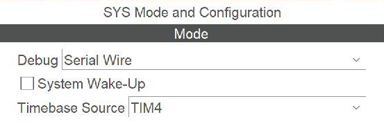

# Hardware Background

## Microcontroller

Labs 1 and 2 target the STM32L073RZT6, an STM32L0 microcontroller with a 32 MHz Arm Cortex-M0+ core, 192 KB of ECC-protected Flash memory, 20 KB of RAM, and 6 KB of ECC-protected data EEPROM. Lab 3 uses the connected NUCLEO-F103RB, whose STM32F103RBT6 has a Cortex-M3 core, 128 KB Flash, and 20 KB RAM.

## Lab 1 board mapping

Lab 1 uses the NUCLEO-L073RZ board configuration:

| Function | MCU signal | Board item | Configuration |
|---|---|---|---|
| User LED | PA5 | LD2, green | Push-pull output, active high |
| User button | PC13 | B1, blue | GPIO external interrupt on falling edge |
| Blink interval | TIM2 update | Internal peripheral | 32 MHz timer clock, 1.5 s update period |
| Debug | PA13 / PA14 | ST-LINK | SWDIO / SWCLK |

The system clock is generated from HSI16 through the PLL with multiplication by 4 and division by 2, producing a 32 MHz SYSCLK. AHB, APB1, and APB2 use a divider of 1.

## Lab 2 board mapping

Lab 2 uses the NUCLEO-L073RZ as the communication master and an Arduino Nano Every as the I2C or SPI slave.

| Function | STM32 signal | STM32 pin | Connected device |
|---|---|---|---|
| Serial terminal transmit | USART2_TX | PA2 | ST-LINK virtual COM port |
| Serial terminal receive | USART2_RX | PA3 | ST-LINK virtual COM port |
| I2C clock | I2C1_SCL | PB8 | Arduino SCL |
| I2C data | I2C1_SDA | PB9 | Arduino SDA |
| SPI clock | SPI1_SCK | PA5 | Arduino D13 |
| SPI master input | SPI1_MISO | PA6 | Arduino D11 |
| SPI master output | SPI1_MOSI | PA7 | Arduino D12 |
| SPI chip select | GPIO output | PB6 | Arduino D10 |
| LED PWM | TIM2_CH1 | PA0 | External LED circuit |
| Servo PWM | TIM21_CH1 | PB13 | Servo control input |

The Arduino I2C slave address is `0x55`. Both boards share a common ground. The I2C bus uses pull-up resistors on SDA and SCL.

## Lab 3 board mapping

| Function | MCU signal | Configuration |
|---|---|---|
| User LED | PA5, LD2 | Push-pull output, active high |
| User button | PC13, B1 | Active low, falling-edge EXTI15_10 |
| Serial transmit / receive | PA2 / PA3, USART2 | ST-LINK virtual COM port, 115200 bit/s, 8N1 |
| RTOS tick | SysTick | 1 kHz |
| HAL tick | TIM4 | 1 kHz |
| Debug | PA13 / PA14 | ST-LINK SWD |

The HSI oscillator supplies 8 MHz. The PLL divides it by two and multiplies by sixteen to produce 64 MHz. HCLK and PCLK2 are 64 MHz; PCLK1 is 32 MHz. The APB1 timer clock is 64 MHz because the APB1 divider is two. TIM4 uses a prescaler of 63 and an auto-reload value of 999.

SVC has interrupt priority 0; PendSV and SysTick use 15. EXTI15_10 and USART2 use priority 5, matching the FreeRTOS maximum system-call interrupt priority. TIM4 uses priority 0 and updates the HAL tick.

The connected ST-LINK exposes COM6 on this workstation. STM32CubeF1 V1.8.5 supplies the HAL, FreeRTOS, and CMSIS-RTOS2 wrapper. Keil uses Arm Compiler 5.06 update 7 and STM32F1xx_DFP 2.4.1.

## Development tools

- STM32CubeMX for pin, clock, interrupt, and peripheral configuration
- Keil MDK-ARM 5 for compilation and debugging
- STM32CubeL0 and STM32CubeF1 HAL and CMSIS device support
